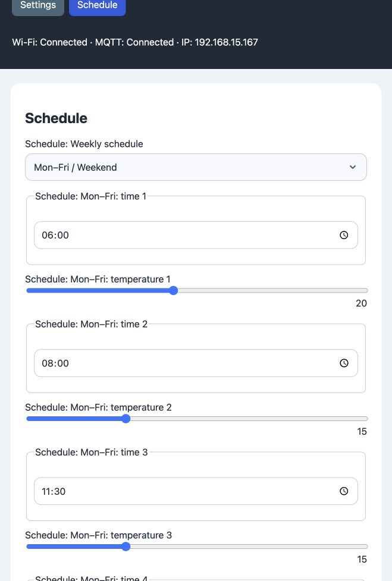
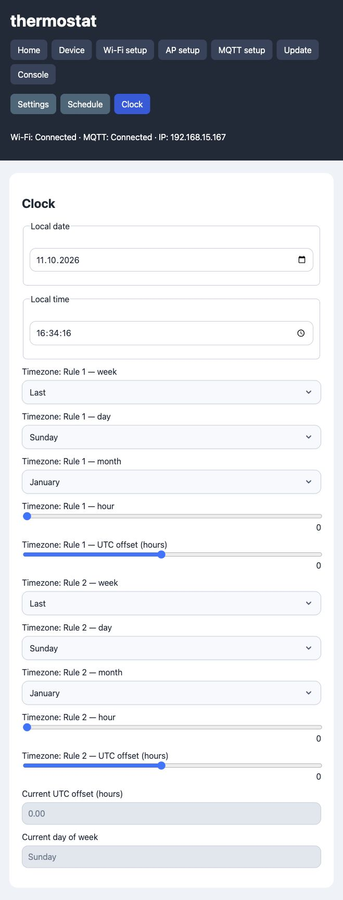

# ESP8266 Tuya ME81H Thermostat with ArdPortal

Replacement Wi-Fi firmware for a **Tuya ME81H thermostat**, using an
**ESP-12F module based on the Espressif ESP8266EX** and
[ArdPortal](https://github.com/rkubera/ArdPortal).

The original **Tuya WBR3 Wi-Fi module has been replaced with an ESP-12F**.
The thermostat's original MCU stays in place: it reads the temperature sensors,
controls the heating relay and display, and runs the weekly schedule. The ESP-12F
communicates with that MCU over the Tuya UART protocol and provides a local web
portal, MQTT, Home Assistant discovery, a console and OTA firmware updates.

## Hardware

The firmware targets the ME81H Tuya thermostat protocol. The published
[ME81H hardware reference](https://templates.blakadder.com/ME81H.html) describes
PCB **ME81H-WIFIMBXIN–B-V1.4**, its WBR3 module and possible ESP replacements.
Other PCB/MCU revisions may use different connections or datapoints.

| ESP-12F connection | Purpose |
| --- | --- |
| GPIO1 / TX0 → MCU RX | Tuya UART transmit |
| GPIO3 / RX0 ← MCU TX | Tuya UART receive |
| 3.3 V and GND | Supply and common ground |
| RST ← original module reset connection | Connect the thermostat's Wi-Fi module reset signal to ESP-12F RST |
| EN | Also soldered/connected in the modified module installation; must be high for the ESP to run |
| GPIO0 / IO0 | Also soldered/connected; high for normal boot, low during reset to enter the UART bootloader |
| GPIO14, optional | Active-low network status signal; verify PCB continuity |

The modified installation also has **RST, EN and GPIO0 (IO0) soldered/connected**,
in addition to power and UART. The **RST connection is required**. Connect the ESP-12F
RST pin to the reset signal used by the original WBR3 module, so the thermostat
can reset the replacement Wi-Fi module. ESP-12F RST is active-low; use the
original module reset connection, not a general-purpose ESP GPIO.

UART uses **9600 baud, 8 data bits, no parity, 1 stop bit**. UART0 is reserved
for the MCU; logs are available in the web console instead of Serial Monitor.
Set `TUYA_STATUS_PIN` to `-1` in [tuya_profile.h](tuya_profile.h) if the optional
status connection is absent. Check the ESP boot-strapping connections against
your actual module and PCB.

The bench-tested ESP-12F has **4 MB Flash**. Select the correct flash layout for
your own module. OTA requires space for both the running and uploaded firmware.

**Disconnect mains power before modifying the thermostat or attaching a USB
programmer. Use a suitable isolated 3.3 V supply for programming.**

## Features

- **Settings:** Climate control with Off, Heat and Auto; sensor selection,
  temperature calibration, panel lock, anti-frost protection, switching differential,
  lower/upper setpoint limits, MCU fault status, rated load power and estimated power/energy.
- **Schedule:** visible in Auto, with program-dependent fields for Mon–Fri /
  Weekend (5+2), Mon–Sat / Sunday (6+1), or Every day (7).
  Each point has a time picker and a **5–40°C slider with a 1°C step**.
- The MCU's startup reports load its schedule. Schedule edits and mode/program
  changes automatically save after a 500 ms editing pause and validation.
  The three programs use the same eight-point MCU schedule; Daily uses six points.
- **Clock:** local date/time and two configurable timezone rules: week, weekday,
  month, transition hour and UTC offset. Default is **UTC with no daylight saving**.
  Offsets support 15-minute increments. Equal offsets disable seasonal changes.
- NTP supplies UTC. The **Timezone** library converts it to local time for the
  portal and Tuya MCU. Changing the rules requests another MCU time update.
- **MQTT and Home Assistant:** ArdPortal manages discovery, availability, commands
  and state. Requested control values appear optimistically; MCU reports correct
  them when needed. Measured temperature and relay state come from the MCU.
- **Console → Messages:** application, MQTT and decoded Tuya TX/RX traffic.
  Routine heartbeat packets are excluded from Messages.
- **OTA Update:** upload a compiled `.bin` through ArdPortal's Update page.
- **Estimated energy:** calculated from rated load wattage and MCU relay reports,
  stored at full precision and displayed with two decimal places. Saved hourly
  and before supported ArdPortal restarts; an unexpected power loss may lose the
  unsaved increment. This is an estimate, not a measured electrical value.
- **Factory Reset:** the existing ArdPortal reset confirmation covers the ESP reset
  and a best-effort MCU reset through `onBeforeFactoryReset`. The MCU reset is sent
  once through DP39 only when the MCU is online, initialized, has reported that
  Boolean datapoint and has no pending commands. Otherwise the console records
  why it was skipped and the ESP reset continues. There is no separate MCU reset
  button, and a transmitted command does not prove the MCU restored its defaults.
- Without an MCU, controls remain available for local preview. Preview edits do
  not queue hardware commands for replay when the MCU reconnects.

MQTT TLS is **disabled in the supplied ESP8266 build**. ArdPortal provides verified
TLS support; enable `ARDPORTAL_ENABLE_MQTT_TLS` in [portal_features.h](portal_features.h)
and configure the broker's TLS settings and CA certificate if required.
TLS memory and responsiveness must be checked on the target ESP-12F.

## Coverage of the original thermostat

**The main heating controls are addressed, but the project does not expose every
original setting remotely and does not replace the factory MCU firmware.**
The ESP-12F replaces the Wi-Fi module. Temperature regulation, relay switching,
local buttons/display and the stored schedule remain the MCU's responsibility.
Behavior of those functions still depends on the original MCU firmware and its
settings, not on a reimplementation in this sketch.

Checked items are supported by the ESP interface or retained in the original
MCU as stated below. Unchecked items have no dedicated remote implementation.

- [x] **Device on/off** — Portal Climate and MQTT/HA, using MCU DP1.
- [x] **Manual heating and automatic scheduling** — Heat/Auto modes, using DP2 and the active weekly program.
- [x] **Target temperature** — Portal/MQTT/HA, whole degrees, respecting MCU lower/upper limits (absolute range 5–90°C; schedules remain 5–40°C).
- [x] **Current temperature and heating indication** — MCU reports exposed through Climate; relay state also drives estimated power.
- [x] **Internal, external or combined sensor selection** — exposed through DP43.
- [x] **Temperature calibration** — exposed through DP27; scaling must be confirmed on other MCU variants.
- [x] **Panel button lock** — exposed through DP40.
- [x] **5+2, 6+1 and daily weekly programs** — program selector, dependent schedule fields and automatic DP38 saving.
- [x] **Local date/time** — NTP plus configurable timezone rules; local time transmitted to MCU.
- [x] **Local panel and autonomous regulation** — retained in the original MCU; the ESP does not run the heating control loop.
- [x] **Switching differential/hysteresis configuration** — DP101, 1–5°C in Settings and MQTT/HA.
- [x] **Anti-frost configuration** — DP10 switch in Settings and MQTT/HA; protection is executed by the MCU, including while off.
- [x] **Upper/lower setpoint limit configuration** — DP19 (30–90°C) and DP26 (5–20°C), Settings and MQTT/HA.
- [x] **Generic MCU fault reporting** — DP45 shown as `OK` or a hexadecimal fault bitmap in the portal and HA.
- [x] **Conditional thermostat factory reset** — the confirmed ArdPortal Factory Reset invokes `onBeforeFactoryReset` and sends DP39 once, only if the MCU has reported DP39 as Boolean and no commands are pending. Offline/unsupported/busy MCU is logged and does not block ESP reset; physical MCU execution remains unconfirmed.
- [ ] **Separate live readings for both sensors** — only the MCU-reported selected temperature is exposed.
- [ ] **Floor over-temperature limit configuration** — no dedicated remote control; configure through the original panel where supported.
- [ ] **Decoded MCU sensor faults** — individual fault bits are not mapped to sensor names without confirmed MCU evidence.
- [ ] **Tuya / Smart Life cloud and vendor-app integration** — replaced by the local ArdPortal/MQTT/Home Assistant interface.

Advanced settings use the [reported ME81H cloud schema](https://github.com/rospogrigio/localtuya/issues/1688), with writes gated by the actual MCU datapoint type. Ranges and write behavior still need validation on your physical MCU. No unsupported writes are replayed from offline preview.

Advanced settings vary between ME81H/ME81AH variants; see the
[original thermostat manual](https://cdn.manomano.com/files/pdf/28419507.pdf)
and the documentation supplied with your exact device. Reported but unmapped
MCU datapoints are not treated as validated writable settings. The sketch must
not be described as full coverage of every original controller feature.

The project adds OTA updates, MQTT/Home Assistant discovery, a local web console,
UART diagnostics, configurable timezone rules and estimated power/energy. These
are ESP-side features. Energy is not measured or calculated by the factory MCU.

## Screenshots

Actual portal screenshots captured during ESP-12F bench testing without the Tuya
MCU. Missing MCU measurements appear as `unknown` in that setup.

### Schedule



### Clock and timezone rules



## Required libraries

| Dependency | Tested version | Installation/source |
| --- | --- | --- |
| ESP8266 Arduino core | 3.1.2 | Arduino Boards Manager: ESP8266 |
| ArdPortal | 0.7.7 | [rkubera/ArdPortal](https://github.com/rkubera/ArdPortal) |
| Timezone by Jack Christensen | 1.2.4 | Arduino Library Manager / [JChristensen/Timezone](https://github.com/JChristensen/Timezone) |
| Time by Paul Stoffregen | 1.6 | Arduino Library Manager / [PaulStoffregen/Time](https://github.com/PaulStoffregen/Time) |

ArdPortal provides **ArdJSON** and **ArdFS**; they do not need separate installs.
`ESP8266WiFi`, `ESP8266WebServer` and `DNSServer` are supplied by the ESP8266 core.
This sketch does not use ArduinoJson, LittleFS, WiFiManager or PubSubClient.

Use ArdPortal with the asynchronous AppConfig registration and configuration APIs
used in this sketch, including `onBeforeFactoryReset`. Use a revision that
includes this callback; the version number alone may not distinguish recent
0.7.7 API changes. Older revisions are not compatible. Tests exercise the
installed library's schema and MQTT command handling as well as the bridge.

## Build and upload

1. Install the ESP8266 core and the libraries listed above.
2. Open [ESP8266-Thermostat-Tuya-ArdPortal.ino](ESP8266-Thermostat-Tuya-ArdPortal.ino)
   in Arduino IDE. Keep the sketch folder name unchanged.
3. Select **NodeMCU 1.0 (ESP-12E Module)** as the tested ESP8266 board profile,
   with a flash layout matching the ESP-12F. That profile name also covers this
   ESP-12F build; it does not mean the thermostat contains a NodeMCU board.
4. For the first upload, connect a 3.3 V USB-UART programmer with the appropriate
   ESP boot mode. Subsequent uploads can use the portal's Update page.
5. Configure Wi-Fi and MQTT through ArdPortal. There is **no migration of settings
   from the previous firmware**.

Arduino CLI, with ArdPortal installed in the standard Arduino libraries folder:

```sh
arduino-cli compile --fqbn esp8266:esp8266:nodemcuv2 .
arduino-cli upload --fqbn esp8266:esp8266:nodemcuv2 --port YOUR_SERIAL_PORT .
```

For OTA, export the compiled binary in Arduino IDE or use Arduino CLI's
`--output-dir` option, then upload the resulting application `.bin` in **Update**.

## Diagnostics and tests

Open `http://<ESP-IP>:8080/diagnostics` for MCU initialization, datapoints,
UART traffic, pending writes, heap statistics and maximum loop times.
`http://<ESP-IP>:8080/ping` provides a simple HTTP responsiveness check.

The current MCU profile uses these datapoints:

| DP | Function |
| --- | --- |
| 1 | Device power |
| 2 | Automatic schedule / manual operation |
| 10 | Anti-frost protection, Boolean |
| 16 | Target temperature, whole °C |
| 19 | Upper setpoint limit, 30–90°C |
| 24 | Current temperature, 0.1°C |
| 26 | Lower setpoint limit, 5–20°C |
| 27 | Signed temperature calibration |
| 36 | Relay report: enum 0 = heating, 1 = idle |
| 38 | Eight time/temperature schedule points |
| 39 | Conditional MCU factory reset, Boolean; not reported by every firmware |
| 40 | Panel button lock |
| 43 | Air / floor / combined sensor selection |
| 45 | Fault bitmap: zero = OK; individual bit meanings unverified |
| 101 | Switching differential, 1–5°C |
| 102 | Weekly program: disabled / 5+2 / 6+1 / Daily |

The Disabled program is not offered in the portal. Entering Auto enables 5+2 if
MCU scheduling was disabled; otherwise it retains the active weekly program.
Confirm datapoint meanings and calibration scaling on other MCU revisions.

Run the native tests with Python 3 and Clang:

```sh
python3 tests/run_tests.py
```

The test runner expects the installed Arduino libraries in a sibling `libraries`
folder, as in a standard Arduino sketchbook. Tests cover UART parsing and command
queues, mode transitions, schedule validation, energy estimation, timezone/DST
boundaries, portal schemas, asynchronous registration, MQTT command handling and
restart energy persistence, advanced setting validation and the factory-reset hook. Hardware timing, OTA and MCU behavior require tests
on the physical thermostat.

For old Home Assistant entities retained from an earlier firmware, use
[tools/remove_legacy_discovery.py](tools/remove_legacy_discovery.py) with the old
MQTT device name. Preview the matching topics before removing them:

```sh
python3 tools/remove_legacy_discovery.py --host BROKER --device OLD_DEVICE --dry-run
```

## License

This project's source code is licensed under the **MIT License**; see [LICENSE](LICENSE).
Dependencies retain their own licenses: ArdPortal is MIT, Timezone is GPL-3.0,
and Time is LGPL-2.1. Dependency source and compiled firmware are not bundled
in this repository.
